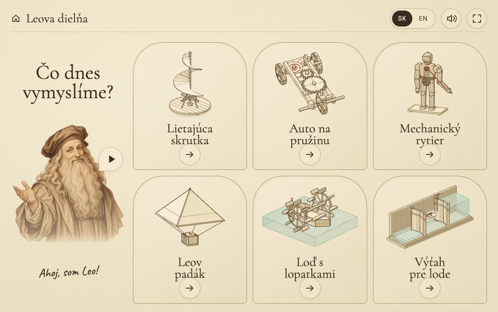

# 🪶 Leo’s workshop / Leova dielňa

A small interactive museum for curious children. Six inventions, four discoveries each: a flying screw, wind-up cart, mechanical knight, parachute, paddle boat and canal lock. English and Slovak, with local narration and a one-screen tablet layout.

Production: [Leo’s workshop](https://leo.virpo.io/). Hosting address: [leo-virpo.netlify.app](https://leo-virpo.netlify.app/).

## Run

`npm ci`, then `npm run dev`. Vite prints the local and Wi-Fi URLs.

`npm run build` produces the static site in `dist/`. Deploy that folder to any static host. Routes use URL fragments, so no server rewrites are required.

## Check

- `npm run check` checks the shared mechanism models.
- `npm run check:browser` checks both languages, all 24 lessons, real MP3 playback, drag, keyboard, reduced motion, and tablet/phone fit in Chrome and WebKit. Set `LEO_TEST_URL` to check another preview URL. Install WebKit with `npx playwright install webkit` first.
- `npm run check:ux` checks narration during immediate touch, held gestures, deliberate pause, route changes, the failed lift and spring tension in both engines.
- `npm run check:experiments` checks new SK/EN audio, landing bounce, simultaneous parachute drops, +/− canopy controls, moving wakes, both propulsion directions and the complete lock puzzle in Chrome and WebKit.
- `npm run check:release` checks the paddle in both drag/key directions, repeated strokes, rapid-tap continuity, explicit replay, phone/portrait targets, malformed links and all 100 published audio assets.
- `node scripts/check-expansion-lines.mjs` optionally checks all new lessons and the robot cords with an installed Anatomy skill. Set `ANATOMY_SKILL_PATH` if it is not in the default skills directory.

The tablet matrix includes 1180×820, 1180×740, 1024×672, 820×1060 and 768×950 usable viewports. See [the screenshot polish report](docs/POLISH.md). `node scripts/capture-polish.mjs NAME` captures the original machine views and gear details. `node scripts/capture-expansion.mjs` captures all new lessons, experiment states, landscape, portrait, phone and 4× junction details into ignored local `artifacts/`.

`node scripts/capture-water.mjs` captures active paddle wakes, canopy controls, landing bounce and each lock waterline, including portrait, phone and 4× details. Action targets are checked against portrait overlap, not only viewport bounds.

## Deploy

Netlify project `leo-virpo`, in the existing `virpo` team, publishes `dist/` using `netlify.toml`. Run `npm run build`, then `netlify deploy --prod --dir dist --no-build`. The GitHub remote is `virpo/leo`. See [deployment notes](docs/DEPLOYMENT.md) for custom-domain configuration. No environment variables or secrets are needed by the app.

## Behaviour

One fixed screen. No page scrolling. Pick a machine, then drag its handle, wheel or cord. The large action button is a tap alternative; holding a turning button keeps it turning. Machines never demonstrate themselves. The car only travels after an explicit release. Reduced motion uses immediate, visible poses.

Touching a model never interrupts Leo. A step's introduction finishes while the child plays. Its discovery follows only after the mechanism settles and a short quiet gap, once per visit. The spring must be fully wound before Leo calls it ready. Holding or dragging postpones the discovery. Explicit pause and mute suppress pending speech, and changing steps discards it.

Tap Leo to pause him, or hear the current explanation again. After discovering a mechanism, he replays its result rather than its introduction. SK / EN switches every title and narration, retaining the current lesson. The speaker in the header mutes speech. Tapping Leo explicitly enables speech again. The separate Home / Domov button returns to the six inventions. Language and mute preference are the only saved settings. There are no accounts, analytics, API keys or runtime speech services.

The complete flying screw makes two grounded rocking attempts and drops back to rest. It never hovers or starts by itself. Spring coils tighten around a fixed outer anchor, with a rust-coloured accent showing stored energy, not heat. The accent fades as the cart uses that energy. Reduced motion omits the rocking.

Parachutes compare equal loads from the same height and bounce gently on landing. In the last lesson, + and − resize the right canopy beside a fixed medium one. Drop both together. Sizing is locked during a drop. The design retains Leonardo's rigid pyramid frame. Paddle strokes follow the finger in both directions and create a visible water wake. Repeated taps make opposite strokes without teleporting the paddle. The boat's third lesson offers Again only after its journey settles. Its final lesson has separate Back and Forward buttons; the discovery waits until both directions have been tried. The lock's final lesson is four deliberate actions: close, fill, open, leave. Rapid taps cannot skip a gate operation or open both ends. Gate panels, posts and sluice stems split at the actual waterline, with submerged wood tinted blue. The robot's pulling cord is longer and highlighted in rust ink. Interaction markers fade after first use so they do not obscure the mechanism. [Research, models and visual checks](docs/EXPANSION.md).

Narration is bundled in 100 local MP3s. Slovak uses native `sk-SK-LukasNeural`, rate −3%, normal pitch. English retains Andrew Multilingual Neural, rate −4%, pitch +3 Hz. Never substitute an English multilingual narrator for Slovak. Settings and audio cache revisions live in `src/voices.js`.

`npm run audio:generate` regenerates missing or changed scripts and narrator settings. Add `-- --force` to rerecord everything. Successful clip fingerprints allow interrupted runs to resume. Generation needs `uvx` and internet; playback does not contact the voice service.

For an unreliable Slovak service, `node scripts/generate-slovak-batch.mjs --record` records all 50 Slovak clips in one native stream, checks the subtitle text and splits at measured silent pauses. Add `--machines=parachute,boat,lock` to record only the expansion, or `--lang=en` for English. Run without `--record` to re-split the matching saved batch, then `npm run audio:generate` to consolidate cache receipts. Markers stay outside the finished clips. This path also needs ffmpeg. Source streams and cut boundaries are local QA artifacts, not required for playback.

For a museum-style iPad view, open the Wi-Fi URL in Safari, then Share → [Add to Home Screen](https://support.apple.com/guide/ipad/open-as-web-app-ipad8f1f7a29/ipados) → Open as Web App if shown. Launch its Leo icon. The site includes standalone metadata and an Apple touch icon. The server must remain available; offline installation is not implemented. No physical iPad has been used for the automated checks.

`src/content.js` contains both languages. `src/model.js` contains mechanism math. `src/art.js` constructs the SVG drawings with the Anatomy kit. `src/leo.js` composes the illustrated portrait and isolates its speaking mouth. `src/main.js` handles routing and direct manipulation, and `src/narration.js` handles local audio. The paper theme is intentionally light.

## Sources and credits

Educational models are simplified, not engineering plans. The screw stays on the ground. The knight is explicitly a modern interpretation of Leonardo’s studies. Research and concept choices are recorded in [DESIGN.md](DESIGN.md).

- [Anatomy](https://github.com/wheresryan22/anatomy), MIT. Vendored kit licence in `src/vendor/ANATOMY-LICENSE`.
- Leo is an original generated pen-and-ink illustration, with an isolated speaking frame. His shading fades into the page and matches its ink palette. Earlier unused portraits are archived locally, outside the shipped assets.
- [Microsoft multilingual voice support](https://learn.microsoft.com/en-us/azure/ai-services/speech-service/language-support) and [edge-tts](https://github.com/rany2/edge-tts).
- Cormorant Garamond, DM Sans and Caveat are self-hosted. Their SIL Open Font Licences are in `public/fonts/`.

Independent project. No museum affiliation.

## License

Open-source application under the [MIT License](LICENSE). Original code, text,
documentation and illustrations are included. Third-party code and fonts retain
their own licenses. Bundled narration recordings are excluded from the MIT grant;
see [licenses and asset notes](NOTICE.md).

The npm package remains marked `private` to prevent accidental package publication.
This does not restrict the public source repository or its MIT license.
