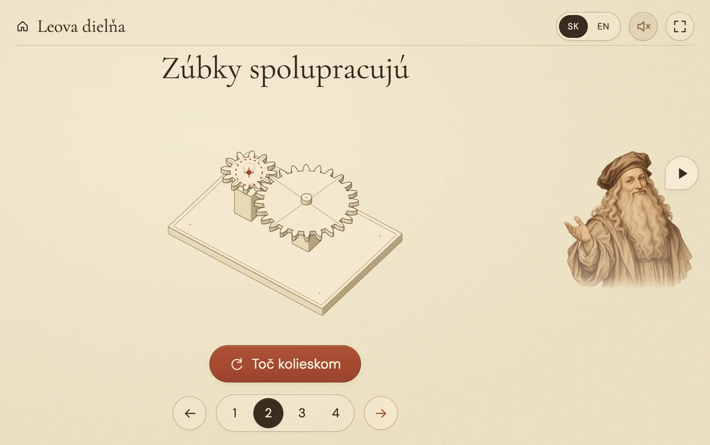

# 🪶 Leo’s workshop / Leova dielňa

A small interactive museum for curious children. Three inventions, four discoveries each: the flying screw, a wind-up cart and a mechanical knight. English and Slovak, with local narration and a one-screen tablet layout.

Production: [Leo’s workshop](https://leo.virpo.sk/). Temporary hosting address: [leo-gamma-one.vercel.app](https://leo-gamma-one.vercel.app/).

## Run

`npm ci`, then `npm run dev`. Vite prints the local and Wi-Fi URLs.

`npm run build` produces the static site in `dist/`. Deploy that folder to any static host. Routes use URL fragments, so no server rewrites are required.

## Check

- `npm run check` checks the shared mechanism models.
- `npm run check:browser` checks both languages, all twelve interactions, real MP3 playback, drag, keyboard, reduced motion, and tablet fit in Chrome and WebKit. Set `LEO_TEST_URL` to check another preview URL. Install WebKit with `npx playwright install webkit` first.

The tablet matrix includes 1180×820, 1180×740, 1024×672, 820×1060 and 768×950 usable viewports. See [the screenshot polish report](docs/POLISH.md). `node scripts/capture-polish.mjs NAME` captures all main views, gear rotation phases and 4× contact details into ignored local `artifacts/`.

## Deploy

Vercel project `echt1/leo` builds `dist/` using `vercel.json`. `vercel deploy --prod --scope echt1` publishes the current source. The GitHub remote is `virpo/leo`. See [deployment notes](docs/DEPLOYMENT.md) for custom-domain configuration. No environment variables or secrets are needed by the app.

## Behaviour

One fixed screen. No page scrolling. Pick a machine, then drag its handle, wheel or cord. The large action button is a tap alternative; holding a turning button keeps it turning. Machines never demonstrate themselves. The car only travels after an explicit release. Reduced motion uses immediate, visible poses.

Tap Leo to hear the instruction or pause him. SK / EN switches every title and narration, retaining the current lesson. The speaker in the header mutes speech. Tapping Leo explicitly enables speech again. Language and mute preference are the only saved settings. There are no accounts, analytics, API keys or runtime speech services.

Narration is bundled in 52 local MP3s. Slovak uses native `sk-SK-LukasNeural`, rate −3%, normal pitch. English retains Andrew Multilingual Neural, rate −4%, pitch +3 Hz. Never substitute an English multilingual narrator for Slovak. Settings and audio cache revisions live in `src/voices.js`.

`npm run audio:generate` regenerates missing or changed scripts and narrator settings. Add `-- --force` to rerecord everything. Successful clip fingerprints allow interrupted runs to resume. Generation needs `uvx` and internet; playback does not contact the voice service.

For an unreliable Slovak service, `node scripts/generate-slovak-batch.mjs --record` records all 26 clips in one native stream, checks the subtitle text and splits at measured silent pauses. Run without `--record` to re-split a locally saved batch. Markers stay outside the finished clips. This path also needs ffmpeg. Source streams and cut boundaries are local QA artifacts, not required for playback.

For a museum-style iPad view, open the Wi-Fi URL in Safari, then Share → [Add to Home Screen](https://support.apple.com/guide/ipad/open-as-web-app-ipad8f1f7a29/ipados) → Open as Web App if shown. Launch its Leo icon. The site includes standalone metadata and an Apple touch icon. The server must remain available; offline installation is not implemented. No physical iPad has been used for the automated checks.

`src/content.js` contains both languages. `src/model.js` contains mechanism math. `src/art.js` constructs the SVG drawings with the Anatomy kit. `src/leo.js` composes the illustrated portrait and isolates its speaking mouth. `src/main.js` handles routing and direct manipulation, and `src/narration.js` handles local audio. The paper theme is intentionally light.

## Sources and credits

Educational models are simplified, not engineering plans. The screw stays on the ground. The knight is explicitly a modern interpretation of Leonardo’s studies. Research and concept choices are recorded in [DESIGN.md](DESIGN.md).

- [Anatomy](https://github.com/wheresryan22/anatomy), MIT. Vendored kit licence in `src/vendor/ANATOMY-LICENSE`.
- Leo is an original generated pen-and-ink illustration, with an isolated speaking frame. His shading fades into the page and matches its ink palette. Earlier unused portraits are archived locally, outside the shipped assets.
- [Microsoft multilingual voice support](https://learn.microsoft.com/en-us/azure/ai-services/speech-service/language-support) and [edge-tts](https://github.com/rany2/edge-tts).
- Cormorant Garamond, DM Sans and Caveat are self-hosted. Their SIL Open Font Licences are in `public/fonts/`.

Independent project. No museum affiliation.
