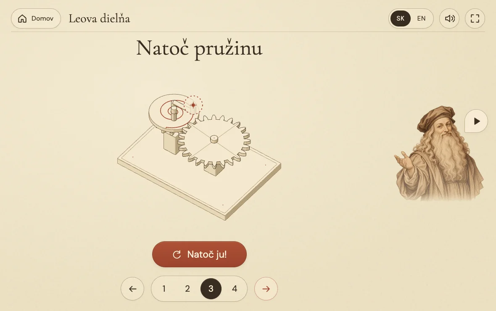

# 🪶 Hands first

## Target

A child can immediately touch a new mechanism without cutting off its explanation. Keep the one-screen notebook, artistic Leo and minimal visible text.

## Before

Model pointer-down called `stopVoice()`. The first action scheduled a different recording after 850 ms, irrespective of the sentence or mechanism. A partial spring winding could trigger “fully wound”. Home was hidden in the workshop title. Spring anchors moved while winding, and the complete screw only spun.

## Changes

1. Finish the current sentence while the child plays. Offer one discovery after both the sentence and mechanism settle, then a 650 ms quiet gap. Another gesture postpones it. Deliberate pause, mute and navigation discard pending speech. Leo replays the discovered result when asked. Selecting the current step does not restart it.
2. Make the screw's failed attempt visible: two increasingly strong rocks about one planted foot, each falling back to a fixed footprint. The second drop is quicker than the build-up. This is an illustrative failed attempt, not simulated aerodynamics or a claim that the original could fly. Reduced motion keeps it grounded without rocking.
3. Separate Home / Domov from the title, with a 48 px control and a larger house icon.
4. Tighten springs around fixed outer anchors. Enlarge the isolated teaching spring and tint its strand progressively with stored energy. The moving cart loses the same accent as its energy empties. No shaking, flashing, heat or danger indication.

## Visual passes

Before captures and motion sheets are in ignored `artifacts/ux-*`. Reproduce the final capture set with `node scripts/capture-ux.mjs`.

The first independent screenshot critique found the spring's geometry change too small at normal size and the failed lift too close to ordinary spinning. The second pass enlarged the teaching spring, strengthened the grounded rocking and separated the portrait speech control from Leo's hat. The house icon was also enlarged. No extra instructional text was added.

The final independent review found no material visual defect in the revised captures. It correctly noted that still frames cannot establish the feel of the rocking motion.

## Proof

- 15 unit checks, including narration cancellation, gesture postponement, once-only results, bounded failed attempts and fixed spring anchors.
- `npm run check:ux`: real MP3 playback during immediate touch, held gestures, result replay, pause, navigation, incomplete winding, completed attempts and reduced motion in Chrome and WebKit.
- `npm run check:browser`: both languages, twelve lessons, five tablet viewport sizes, no scrolling, no idle motion, drag and keyboard controls.
- Rendered landscape, portrait and compact-tablet captures. Enlarged spring detail and six-frame failed-attempt sheet.
- Targeted Anatomy line-end checks report zero floating ends for the spring at rest and wound, the complete cart and the complete screw, with clean consoles. The legacy whole-machine geometry audit remains unimplemented, as recorded in [POLISH.md](POLISH.md).

## Verdict

Implemented locally and browser-verified. Not yet committed, pushed or deployed. Physical iPad Safari and a child play-test remain manual checks. The spring hue is deliberately a secondary cue; its coil geometry changes too.
